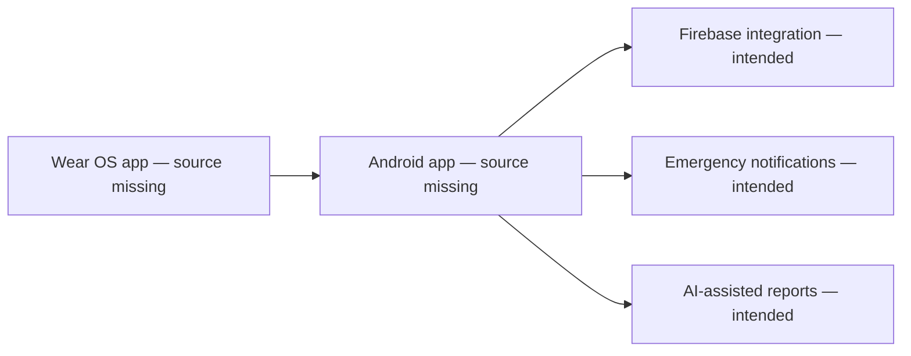

# SmartHealthWear

An academic team-project direction for Android/Wear OS health monitoring and phone integration. This public repository currently contains **partial configuration and documentation**, rather than a buildable application.

## What can be inspected here

- Root Android/Gradle configuration declares Kotlin, Firebase plugins, and `app` / `wear` modules.
- Firestore rules restrict user paths by authenticated UID; their deployed behavior has not been verified.
- Development scripts and historical setup notes refer to health-monitoring components.

**Missing from this repository:** `app/`, `wear/`, application source, manifests/resources, Gradle wrapper, executable tests, and a demonstrated build. References in documentation/logs are not evidence that a feature is implemented.

## Intended system

This diagram describes the intended architecture, not demonstrated runtime behavior.

## Build and setup status

The root `settings.gradle` includes `:app` and `:wear`, which are absent. No installation/run/test command can be verified from the current public tree. See [setup status](SETUP_GUIDE.md). Restore the complete, rights-cleared team source before adding normal build instructions or CI.

## Team contribution and rights

Hussein Nabil Akil is the repository owner. The visible commits are an initial commit and a file upload; they do not establish who implemented specific application features. The project is collaborative. Collaborator names, module ownership, and Hussein's individual contributions should be added only after confirmation from project records and the team. No individual implementation credit is inferred from a bulk upload.

## Limitations and next work

No clinical validation, medical reliability, standards certification/compliance, working emergency delivery, real-device monitoring, or deployed Firebase protection is demonstrated by this repository.

1. Recover complete source, wrapper, and tests with appropriate publication rights.
2. Credit teammates and document implemented versus planned features.
3. Verify build and simulator/device behavior, then add synthetic-data screenshots.
4. Review permissions, backup/data handling, Firebase rules, and external AI transmission before a public demo.

Health features are educational; do not rely on this repository for medical decisions or emergency services.
